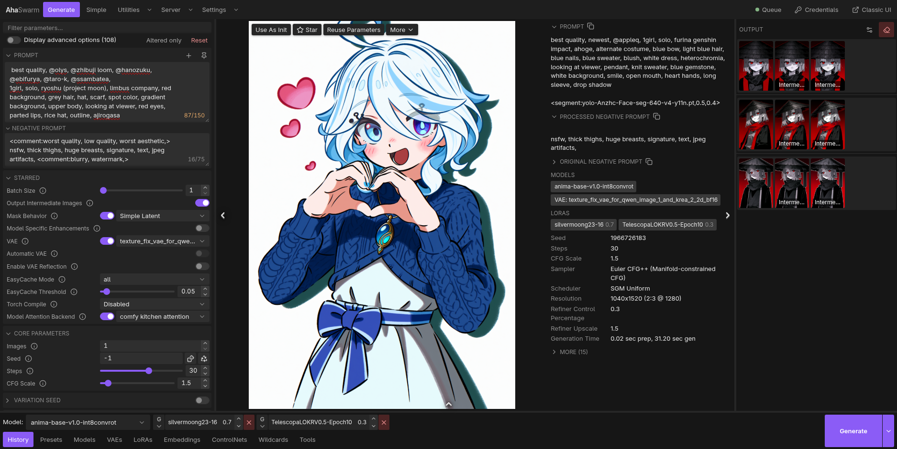

# AhaSwarm



A cleaner, smoother frontend for [SwarmUI](https://github.com/mcmonkeyprojects/SwarmUI), packaged as a SwarmUI extension.
It reimplements the Generate tab on top of SwarmUI's normal HTTP/WebSocket API, so it runs side by side with the classic UI.

Mobile layout is planned.

## Install

1. Copy (or `git clone`) this folder inside `SwarmUI/src/Extensions`.
2. Restart SwarmUI. Swarm builds the C# part of the extension automatically.
3. Open `http://<swarmui-url>/Aha/`, or click the **AhaSwarm ↗** tab that the extension adds to the classic UI.

Launch mode: to have SwarmUI open AhaSwarm instead of the classic UI when it starts, pick `aha` as the Launch Mode in
Server Configuration (AhaSwarm: Settings → Server Settings), or start SwarmUI with `--launch_mode aha`.

The built web app (`Assets/app/dist/`) is committed on `master` by a GitHub Action whenever the frontend changes, so a
plain clone or update works without Node.js. You only need Node.js to build it yourself. Your own builds go to
`Assets/app/dev/` (gitignored), and the extension serves whichever of the two was built last `<meta name="aha-build-time" content="timestamp">`. To force one, start SwarmUI
with `--aha_build dist` or `--aha_build dev`, leave it on `auto` (default) unless you're doing shenanigans.

## Build the frontend

Requires Node.js 18, 20 or 22+ (the versions Vite 6 supports).

```bash
cd frontend
npm ci
npm run build      # outputs to ../Assets/app/dev (relative base paths, plus a legacy bundle for older browsers)
npm run check      # svelte-check / TypeScript
```

Dev server with hot reload, proxied to a running Swarm:

```bash
cd frontend
SWARM_URL=http://127.0.0.1:7801 npm run dev
```

Open `http://localhost:5173/Ahadev/` while `npm run dev` is running. The dev server proxies `/API`, `/View`
and the other Swarm endpoints to `SWARM_URL`, so you get live reloads without rebuilding.

The dev server always uses Vite's default port 5173. The extension also maps `/Ahadev/` on the Swarm port,
this proxy only works when the extension is loaded and can reach the dev server; 
if `http://127.0.0.1:7801/Ahadev/` does not load, use the Vite dev URL.

## Contributing

If you encounter a bug please [open an issue](https://github.com/AshtakaOOf/AhaSwarm-SwarmUI/issues/new) and provide a way to reproduce it.

For contributing code please tackle [issues](https://github.com/AshtakaOOf/AhaSwarm-SwarmUI/issues) or features you find broken/missing from the original, if they are related to a SwarmUI extension open an issue first to discuss.

## Browser support

Targets current evergreen browsers. A legacy bundle with polyfills covers older engines (because why not), down to about iOS/Safari 12, Chrome 64, Firefox 68 and Samsung Internet 9 (the floor is Svelte 5's need for `Proxy`). (Polyfills might get removed later on)

In terms of performance AhaSwarm runs perfectly fine in Chromium 156, Firefox 159, Safari 27 (WebKit 625.1.29) and pretty well on Epiphany 51.2 (WebkiGTK 2.54.2).

## License

MIT, see the `LICENSE` file.

## Credits

AhaSwarm is built on [SwarmUI](https://github.com/mcmonkeyprojects/SwarmUI) by mr Alex "mcmonkey" Goodwin (MIT), whose server, API and classic frontend it follows as the spec (usually), and [ComfyUI](https://github.com/comfyanonymous/ComfyUI) by comfyanonymous (GPL-3.0), SwarmUI's main generation backend.

The app uses [Svelte](https://svelte.dev) (MIT) and [Lucide](https://lucide.dev) icons (ISC); the build uses [Vite](https://vite.dev), [Tailwind CSS](https://tailwindcss.com), [TypeScript](https://www.typescriptlang.org) and `svelte-check`.

Theme palettes are adapted from [Catppuccin](https://catppuccin.com), [Gruvbox](https://github.com/morhetz/gruvbox), [Rosé Pine](https://rosepinetheme.com), One Dark, [Adwaita for Steam](https://github.com/tkashkin/Adwaita-for-Steam) (plus [vgui.css](https://github.com/AlpyneDreams/vgui.css)), [MoreThemes](https://github.com/mrblomblo/MoreThemes), [ParaOre-UI](https://github.com/anylyralabs/ParaOre-UI) (OreUI), GNOME [libadwaita](https://gitlab.gnome.org/GNOME/libadwaita) (LGPL-2.1-or-later) and [shadcn/ui](https://ui.shadcn.com).

No fonts are bundled; the UI uses the system font stack. (This might change because I might force everyone to use Inter)
